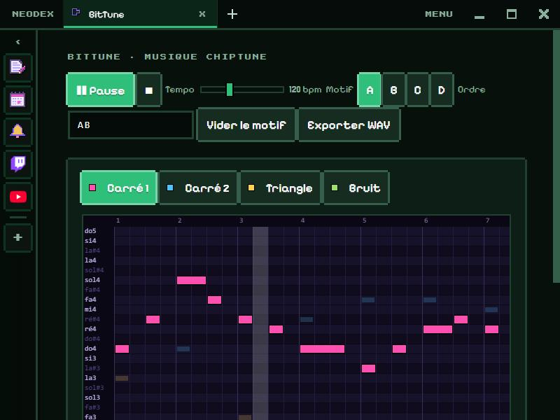

# BitTune

Compose chiptune music, with the 4 voices of old 8-bit consoles.

*Version française : [README.md](README.md)*

## Voices

- **Square 1** and **Square 2**: melody and accompaniment. Three wave shapes: 12.5 %, 25 % or 50 % duty cycle (from nasal to round).
- **Triangle**: the bass, one octave lower.
- **Noise**: the drums (kick, snare, hi-hat, cymbal), from a shift-register noise like the NES one.

Each voice has its own volume. The other voices' notes stay visible, faded, to find your way.

## Composing

- The grid is 32 steps (8 beats) over two octaves, from C3 to C5.
- **Click** to place a note (you hear it), **drag right** to hold it, **right click** to erase it.
- 4 patterns, **A**, **B**, **C** and **D**, and a free **order** (for example `AABACD`, 64 at most).
- **Tempo** from 60 to 240 bpm. **Space**: play or pause; playback loops and follows the playing pattern.

## Export

**Export WAV** renders the whole song in 44.1 kHz stereo.

## Data

The patterns, the order, the tempo and the voice settings are kept in the plugin folder. Permission: `storage` only.
