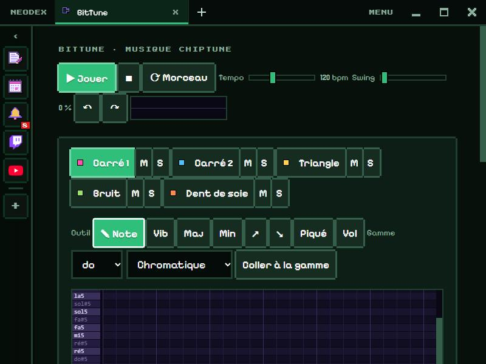

# BitTune

Compose de la musique chiptune, avec les 5 voies des vieilles consoles 8 bits, des effets par note, et l'export en WAV ou en MIDI.

*English version: [README.en.md](README.en.md)*

## Les voies

- **Carré 1** et **Carré 2** : la mélodie et l'accompagnement. Trois formes d'onde : rapport cyclique 12,5 %, 25 % ou 50 % (du plus nasillard au plus rond).
- **Triangle** : la basse, une octave plus bas.
- **Bruit** : 6 percussions (grosse caisse, caisse claire, charleston, cymbale, charleston ouvert, tom), tirées d'un bruit à registre comme celui de la NES.
- **Dent de scie** : une voix plus brillante, pour les solos et les nappes.

Chaque voie a son **volume**, son **panoramique** (gauche ou droite), son **écho**, son **octave** (−2 à +2), et les boutons **M** (muet) et **S** (solo). Les notes des autres voies restent visibles en pâle.

## Composer

- La grille fait 32 pas (8 temps) sur trois octaves, de do3 à do6, avec le clavier à gauche.
- **Clic** pour poser une note (on l'entend), **glisser vers la droite** pour la tenir, **clic droit** pour l'effacer.
- **Effets par note** : choisis un outil puis clique une note. **Vib** (vibrato), **Maj** et **Min** (arpèges majeur et mineur, à la façon des consoles), **↗** (arrive en glissant), **↘** (chute de deux octaves, effet laser), **Piqué** (note très courte), **Vol** (4 niveaux de volume, chaque clic baisse d'un cran).
- **Gamme** : choisis la tonique et la gamme (majeur, mineur, pentatonique, penta mineure, blues) ; les notes hors gamme sont assombries, et **Coller à la gamme** les rend impossibles à poser.
- 8 motifs, de **A** à **H**, et un **ordre** libre (par exemple `AABACDGH`, 64 au plus). **Copier**, **Coller**, **Vider** un motif, **transposer** une voie d'un demi-ton ou d'une octave.
- **Tempo** de 60 à 240 bpm, **swing** de 0 à 50 %. **⟳** joue tout le morceau ou seulement le motif affiché, en boucle. Un oscilloscope montre l'onde pendant la lecture.
- **Espace** : lecture ou pause · **Ctrl+Z / Ctrl+Y** : annuler / refaire.
- **Exemples** : trois morceaux tout faits (Départ, Aventure, Donjon) pour voir comment c'est construit.

## Exporter

- **Exporter WAV** rend tout le morceau en stéréo 44,1 kHz, effets et écho compris.
- **Exporter MIDI** donne un fichier pour ton logiciel de musique : une voie MIDI par voie, les percussions sur la voie 10.
- **Enregistrer le morceau** et **Ouvrir un morceau** : un fichier `.bittune.json` pour le garder ou le partager.

## Données

Les motifs, l'ordre, le tempo et les réglages des voies sont gardés dans le dossier du plugin. Autorisation : `storage` seulement.
